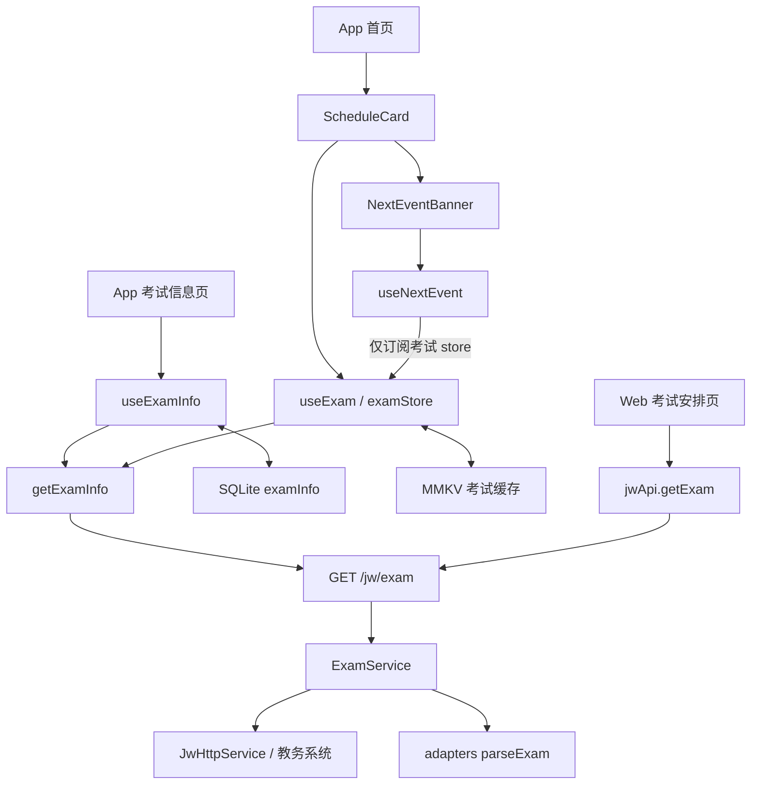

# 考试信息查询 S0 核查记录

| 项目 | 记录 |
| --- | --- |
| 核查日期 | 2026-10-22，Asia/Shanghai |
| 对应契约 | [考试信息查询契约、实现差异与改造计划](exam-info-query.md) 的 S0 |
| 本地核查状态 | 已完成：部署候选、客户端地址、依赖声明/锁定/安装/解析入口、当前工作区内考试调用方及影响范围 |
| 线上核查状态 | 已读取公开 Swagger；实际运行提交、镜像及容器内 adapters 版本待补证 |
| 用户确认的处理方式 | 先记录本地核查结果，线上项待补证 |
| S0 整体状态 | 部分完成，不标记为已完成生产部署基线确认 |
| 本次修改范围 | 仅新增本记录，并在契约文档增加进度链接；未改业务代码、依赖、锁文件、迁移或运行配置 |

## 1. 核查结论

1. 当前工作区有两份具备生产部署配置的同类后端：`monorepo/apps/backend` 与独立 `tool-app-be`。两者都暴露 `GET /jw/exam`，都使用 `8686`，但构建上下文和 adapters 来源不同。仓库配置本身不能证明线上实际运行哪份。
2. 公网 HTTP/HTTPS Swagger 均可读取，包含 `/jw/exam`，以及本地 monorepo 有、独立后端当前源码没有的三条空教室路由。因此，线上功能集合更接近当前 monorepo。该判断是路由特征推断，不能据此认定线上等于某个本地提交或 adapters `1.1.1`。
3. 本地 monorepo 后端通过 `workspace:*` 使用 `@gxutool/adapters`，实际链接到 `packages/adapters`，版本为 `1.1.1`。独立后端使用旧 `gxu-tool-adapters` Git 包，锁定提交 `fef1d115e5439390e5e258ece05f5bb417a508eb`，包内版本为 `1.0.0`。
4. App 同时安装 `@gxutool/adapters@1.0.1` 与旧 Git 包。考试 API 和考试模型都仅从旧包 `import type { Exam }`，不在 App 执行 `parseExam`；解析发生在后端。单独升级 App 的 adapters 不会改变考试响应的解析行为。
5. 对本地四处已安装/构建的考试产物进行规范化比较后，`exam/parser.js`、`exam/schema.js` 及模型声明分别一致，仍是解析失败返回 `null`、关键字段可缺失并默认空串。版本号不同不意味着考试行为已经修复。
6. 当前已知客户端有两个 HTTP 封装入口：App `getExamInfo` 与 Web `jwApi.getExam`。App 有两个业务查询调用点，Web 有一个页面调用点；首页“下一事件”另有一个只读 store 消费者。

这里的“全部调用方”限定为本次核查的工作区源码、路由和静态引用；不包含无法从本地枚举的外部 API 使用者、已发布旧 App/OTA 或线上被替换的前端产物。

## 2. 证据边界与工作区基线

### 2.1 代码版本

| 目录 | 当前分支 | HEAD | 与考试相关的角色 |
| --- | --- | --- | --- |
| `gxu_tool_app` | `v2.2` | `1376d745fd1139232be0a51d560539fd0f485513` | App 查询、SQLite/MMKV、课表与下一事件 |
| `monorepo` | `main` | `5458bcfb6cf71beb83dbe082e0a433c520c70b1e` | 当前整合后端、Web、共享 adapters 与部署配置 |
| `tool-app-be` | `master` | `832aba4536fa131d343154d8d43e718b24f939f1` | 独立后端及另一套生产部署配置 |
| `tool-adapter` | `main` | `fef1d115e5439390e5e258ece05f5bb417a508eb` | 旧 Git 包源码，与直接锁定提交对应 |
| `GxuToolWebBE` | `main` | `5bcb9ccbccda0b1bde64321831c3df1406071aab` | 另一套历史账号体系和考试接口，单独界定影响 |

核查读取了工作区当前内容，不能只用 HEAD 描述全部文件状态。App 的 `ScheduleCard.tsx`、底部弹层、首页路由、账号页等已有未提交修改；独立后端的教师模块和 monorepo 的后台 Vite 配置也有既有修改。后续改造须保留这些内容，尤其不能用 HEAD 版本覆盖当前首页调用关系。

核查前记录了以上五个仓库现有 tracked diff 的 SHA-256，交付前再次比较。文档变更与业务变更分开记录；没有执行依赖安装、构建、迁移、服务启动、流水线触发或部署。

### 2.2 公开线上证据

| 核查对象 | 本次观察 | 可以证明 | 不能证明 |
| --- | --- | --- | --- |
| [HTTPS Swagger JSON](https://api.tool.gxutech.xyz/docs-json) | HTTP 200，OpenAPI 3.0.0，包含 `/jw/exam` | 该公网 HTTPS 入口当前公开的接口描述 | 运行提交、镜像、容器内依赖及实际接口行为 |
| [HTTP Swagger JSON](http://api.tool.gxutech.xyz/docs-json) | HTTP 200，最终 URL 仍为 HTTP；路由名称集合及考试描述与 HTTPS 所见相同 | App 配置使用的 HTTP 地址当时可读取相应描述 | 两个协议一定由同一实例或同一构建处理 |
| 线上空教室路由 | `/jw/emptyClassroom/place`、`/jw/emptyClassroom/building`、`/jw/emptyClassroom` 均出现在描述中 | 线上具备这组路由描述；本地 monorepo 对应功能于 `aa9bc20` 加入 | 实际服务的提交号或部署来源；功能可能被复制到其他分支 |
| Swagger `info.version` | `1.0.0` | API 文档版本字符串 | 不是后端 Git SHA，也不是 adapters 版本；两份本地 `main.ts` 都硬编码该字符串 |
| 两个 GitLab 项目的公开 API | 对 `gxutool/tool-mono-repo` 与 `gxutool/proxy-board` 均返回 404 | 未认证读取无法取得项目/部署元数据 | 不能推断项目不存在或没有成功部署 |
| 浏览器 GitLab 项目访问 | 跳转到登录页，未有可用登录会话 | 本次无法查看私有流水线与部署任务 | 不证明仓库或生产服务不存在 |
| 本机 Docker | 当前 context 为本机 `desktop-linux`；daemon 管道不存在 | 本机没有可用的该 Docker 运行会话 | 与生产宿主机的 Docker 状态无关 |

本次仅访问公开文档元数据，没有登录用户账号、请求个人考试信息或把 Swagger 描述视为实际接口行为测试。未从线上读取到镜像 ID、构建提交、运行包版本或实现中的 `parseExam`。

## 3. 部署地址、构建来源与候选差异

### 3.1 客户端实际配置

| 使用场景 | 当前代码中的地址链 | 证据 | 核实状态 |
| --- | --- | --- | --- |
| App 考试查询 | `getExamInfo` → `backendHttp` → `http://api.tool.gxutech.xyz/jw/exam` | [App API](D:/coding/gxu-tool/gxu_tool_app/src/features/examInfo/api/index.ts:23)、[backendHttp](D:/coding/gxu-tool/gxu_tool_app/src/features/backend/api/index.ts:3) | 源码地址已确认；已发布 App/OTA 的地址尚未核对 |
| App 教务登录/Cookie 同步 | 后端域为 `http://api.tool.gxutech.xyz`；与教务域进行 Cookie 同步 | [JwAuthClient](D:/coding/gxu-tool/gxu_tool_app/src/core/auth/Jw/JwAuthClient.ts:11) | 本地配置已确认 |
| Web 开发 | `/api/jw/exam` → Vite 去掉 `/api` → `https://api.tool.gxutech.xyz/jw/exam` | [vite.config.ts](D:/coding/gxu-tool/monorepo/apps/web/vite.config.ts:22) | 开发配置已确认 |
| Web 生产镜像 | `/api/jw/exam` → Nginx `/api/` 代理 → `http://10.0.0.3:8686/jw/exam` | [nginx.conf](D:/coding/gxu-tool/monorepo/apps/web/nginx.conf:13)、[Web Dockerfile](D:/coding/gxu-tool/monorepo/apps/web/Dockerfile) | 镜像构建配置已确认；线上 Web 的实际配置及该内网地址的宿主归属待补证 |

因此，“App 与 Web 最终访问同一生产实例”目前没有闭环证据。公网域名的反向代理与 `10.0.0.3:8686` 之间的映射是后续必须补齐的一项。

App 考试数据 API 当前直接使用 `backendHttp`，没有经过 `runJw` 的远端/本地切换；认证可能走本地登录，不代表考试数据查询具备本地直连回退。

### 3.2 两份后端部署配置

| 项目 | Monorepo 后端 | 独立后端 |
| --- | --- | --- |
| Git remote | `gxutool/tool-mono-repo.git` | `gxutool/proxy-board.git` |
| 源码路径 | `monorepo/apps/backend` | `tool-app-be` |
| 部署任务 | `deploy_backend` | `deploy_to_server` |
| 触发分支 | `CI_DEFAULT_BRANCH`，本地分支为 `main`；未取得远端默认分支证据 | CI 显式要求 `master` |
| runner 选择 | tag `backend` | tag `backend`；tag 相同不能证明宿主机相同 |
| Compose 项目/服务 | 显式项目 `tool-app`，服务 `backend` | 服务 `tool-app-backend`，项目名取决于运行目录或环境 |
| 构建上下文 | monorepo 根目录，Dockerfile 为 `apps/backend/Dockerfile` | 独立仓库目录，Dockerfile 为 `Dockerfile` |
| adapters 构建 | workspace 安装，构建共享包并将其 `dist` 复制进运行镜像 | 按独立锁文件安装 Git 依赖，生产阶段也执行 frozen install |
| 发布执行 | `docker compose build backend`，然后 `up -d --remove-orphans backend` | `docker compose build --no-cache tool-app-backend`，然后 `up -d` |
| 对外端口 | `8686:8686` | `8686:8686` |
| 后端 manifest 版本 | `0.0.1` | `0.0.1`；不能用该版本区分部署 |
| 可追踪构建信息 | Dockerfile 未写入提交/revision 标签，公开文档无构建指纹 | 同样未提供可确认 Git SHA 的公开构建标识 |

依据：[Monorepo CI](D:/coding/gxu-tool/monorepo/.gitlab-ci.yml:183)、[Monorepo Dockerfile](D:/coding/gxu-tool/monorepo/apps/backend/Dockerfile)、[Monorepo Compose](D:/coding/gxu-tool/monorepo/apps/backend/docker-compose.yml:1)、[独立 CI](D:/coding/gxu-tool/tool-app-be/.gitlab-ci.yml:33)、[独立 Dockerfile](D:/coding/gxu-tool/tool-app-be/Dockerfile)、[独立 Compose](D:/coding/gxu-tool/tool-app-be/docker-compose.yml:16)。

Monorepo 的部署任务配置了 `allow_failure: true`。将来取得 CI 访问后，必须查看具体部署 job 的状态、提交和日志，不能把整条 pipeline 成功当作生产部署成功；即使部署 job 成功，仍需对应到实际接收流量的实例。

## 4. Adapters 依赖核查

### 4.1 声明、锁定、安装与实际入口

| 消费方 | 声明 | 仓库及安装锁定 | 本地实际解析 | 考试链使用方式 |
| --- | --- | --- | --- | --- |
| App 新包 | `dependencies` 中 `@gxutool/adapters: 1.0.1` | 两份锁文件均为 `1.0.1`；tarball 指向 GitLab project 86 的包注册表 | `node_modules/@gxutool/adapters` → `.pnpm/@gxutool+adapters@1.0.1/...` | 当前考试链未从此包导入 `Exam` 或 `parseExam`；其他功能使用 attendance/teacherInfo 子入口 |
| App 旧包 | `devDependencies` 中 `gxu-tool-adapters`，Git URL | 直接 importer 锁定 `fef1d115e5439390e5e258ece05f5bb417a508eb`；安装锁一致 | 包版本 `1.0.0`；`./jw` 导出到 `package/adapter-jw/dist/index.js` | 两个考试文件均显式 `import type { Exam }`；类型被擦除，不在 App 运行考试 parser |
| Monorepo 后端 | `@gxutool/adapters: workspace:*` | root 锁文件及安装锁为 `link:../../packages/adapters` | junction 指向 `monorepo/packages/adapters`，manifest `1.1.1`，入口 `dist/jw/index.js` | 后端考试服务运行时调用此包的 `parseExam` |
| 独立后端 | `gxu-tool-adapters`，Git URL | 直接 importer 与安装锁均锁定 `fef1d115e5439390e5e258ece05f5bb417a508eb` | 包版本 `1.0.0`，入口 `package/adapter-jw/dist/index.js` | 后端考试服务运行时调用旧包的 `parseExam` |
| Web | 未声明 adapters | Web importer 无该依赖 | 使用自身 `types/exam.ts` 与工具箱 API | 由后端解析，本地没有 `parseExam` 调用 |

本地解析通过 `fs.realpathSync`、包 manifest、`exports` 及 `require.resolve(.../jw)` 核查，没有执行解析器或启动业务服务。两个本地后端现有编译产物的 import 也分别为 `@gxutool/adapters/jw` 和 `gxu-tool-adapters/jw`；编译产物存在不等于它已经部署。

依据：[App manifest](D:/coding/gxu-tool/gxu_tool_app/package.json)、[App 锁文件](D:/coding/gxu-tool/gxu_tool_app/pnpm-lock.yaml:11)、[Monorepo 后端 manifest](D:/coding/gxu-tool/monorepo/apps/backend/package.json)、[Monorepo 锁文件](D:/coding/gxu-tool/monorepo/pnpm-lock.yaml:57)、[共享包 manifest](D:/coding/gxu-tool/monorepo/packages/adapters/package.json)、[独立后端 manifest](D:/coding/gxu-tool/tool-app-be/package.json)、[独立后端锁文件](D:/coding/gxu-tool/tool-app-be/pnpm-lock.yaml:56)。

### 4.2 旧包的第二个 Git 提交

App 锁文件还存在 `f055dfbefd8813a80cf1f000720ce6ada91e5090`。它来自旧包根 manifest 内再次依赖 `gxu-tool-adapters` 的间接依赖；App 的直接 importer 仍是 `fef1d115...`。不能只检索到第二个 SHA，就把它当成 App 直接依赖版本。

当前直接导入的 `./jw` 按根包 `exports` 定位到 `package/adapter-jw/dist/index.js`。旧根包中存在同名依赖是额外的依赖维护问题，考试 S1 不需要顺便重写整条旧包依赖树。

### 4.3 考试实现内容比较

比较对象为：App 中的新包 `1.0.1`、App 中的旧 Git 包、独立后端中的旧 Git 包、monorepo 共享包当前 `dist`。

比较前统一 CRLF/LF，去除 `sourceMappingURL` 注释并去掉首尾空白。结果如下：

| 文件 | 四处产物的规范化 SHA-256 | 观察 |
| --- | --- | --- |
| `exam/parser.js` | `ef4d3f0df13cc91296401537d09169aef748acd1ec9c7ed00a5eeb8853756a80` | 内容一致；`safeParse` 失败后返回 `null` |
| `exam/schema.js` | `4aa46b03f5b99c078244fcd8a0f5a6b65ca4f3432279d4f50ed05708f071febf` | 内容一致；`sjbh/kcmc` 等可选并默认空串 |
| `exam/schema.d.ts` | `7baa84c47a6e50a4cc366313a3dfbe8a80e3b098828912f7b9f47da0cdb7d9e4` | 当前考试模型声明一致 |

该比较只说明上述考试文件一致，不说明整个包一致，更不证明生产容器使用其中任何一份。

App 源码 300 个 TS/TSX/JS/JSX 文件的静态扫描发现：旧 `gxu-tool-adapters/jw` 被 26 个文件导入，新 attendance 子入口被 3 个文件导入，新 teacherInfo 子入口被 7 个文件导入。旧包仍有明确运行时调用，例如 [src/js/jw/course.ts](D:/coding/gxu-tool/gxu_tool_app/src/js/jw/course.ts:18) 的 `parseSchedule`。考试的两个类型导入不构成删除旧包的充分条件；其余普通导入是否仅用于类型，应在未来包迁移时另行逐项确认。

### 4.4 依赖更新路径

- 若实际部署来自 monorepo：S1 修改并验证 workspace 适配器及后端，后端 Docker 构建会一并构建和复制共享包；不能仅发布 npm 包就假定生产 workspace 自动改变。
- 若实际部署来自独立后端：S1 还必须明确 Git 包升级/新包切换方式，更新独立仓库的 manifest 与锁定提交，并重新构建该部署源。
- App 新包升级需要显式版本及锁文件更新；旧包升级需要显式 Git 锁定更新。考试契约改造本身不要求为了“版本一致”同时切换全部 App 业务依赖。
- Web 的考试 API/类型应随接口契约调整；不需要为了使用考试数据新增 adapters 运行时依赖。
- Monorepo 已配置 `adapters-v<版本>` 标签发布任务，但本次未取得成功发布记录。`packages/adapters/package.json` 中的 `1.1.1` 不构成注册表已经发布该版本的证据。

## 5. 当前考试调用链与全部已知消费者

### 5.1 调用关系

这是当前结构，不是目标架构；图中的 SQLite 与 MMKV 是两个独立持久化入口。后端框对应两份同路由实现的候选，而非已确认的生产仓库。

### 5.2 发起请求与读写数据的消费者

| 编号 | 调用方 | 触发/用途 | 下游及持久化 | 影响判断 |
| --- | --- | --- | --- | --- |
| Q-01 | [App ToolboxStack](D:/coding/gxu-tool/gxu_tool_app/src/route/screens/ToolboxStack.tsx:88) → [ExamInfo](D:/coding/gxu-tool/gxu_tool_app/src/features/examInfo/screens/ExamInfo.tsx:17) | 进入考试页、选择学期、点击重试；当前关闭全部学年/整学年选项 | `useExamInfo` 的本地读取和远端刷新 | 活跃页面入口，S2/S5 必须覆盖 |
| Q-02 | [useExamInfo](D:/coding/gxu-tool/gxu_tool_app/src/features/examInfo/hooks/useExamInfo.ts:58) | App 业务查询点 1 | 调用 `getExamInfo`；读取/替换 SQLite；生成页面状态 | 直接受返回值、错误、认证、事务与并发契约影响 |
| Q-03 | [HomeScreen](D:/coding/gxu-tool/gxu_tool_app/src/features/courseSchedule/screen/HomeScreen.tsx:16) → [ScheduleCard](D:/coding/gxu-tool/gxu_tool_app/src/features/courseSchedule/components/ScheduleCard.tsx:79) | 首次初始化、学期变化、手动刷新 | `loadExamCache`、`initExam`；课表渲染 `NewExamItem` | 活跃入口；已有未提交改动，后续须在当前版本上接入 |
| Q-04 | [useExam](D:/coding/gxu-tool/gxu_tool_app/src/features/courseSchedule/hooks/detail/useExam.ts:106) | App 业务查询点 2 | 调用同一个 `getExamInfo`；独立 MMKV 和模块级 Zustand store；`normalizeExam` 转日程项 | S3/S4/S5 必须统一查询及快照来源 |
| Q-05 | [NextEventBanner](D:/coding/gxu-tool/gxu_tool_app/src/features/courseSchedule/components/NextEventBanner.tsx:11) → [useNextEvent](D:/coding/gxu-tool/gxu_tool_app/src/features/courseSchedule/hooks/detail/useNextCourse.ts:36) | 首页下一课程/考试/假期提示 | 订阅 `useExam` 的 `examList`，不自行调用 `getExamInfo` | 间接消费者；不能误算为第三个考试请求点 |
| Q-06 | [Web router](D:/coding/gxu-tool/monorepo/apps/web/src/router/index.ts:29) → [ExamRoomPage](D:/coding/gxu-tool/monorepo/apps/web/src/views/exam/ExamRoomPage.vue:23) | `/tool/exam-room`，挂载查询与点击查询 | 调用 `jwApi.getExam`；当前仅页面内存，没有考试专用持久化 | 唯一已知 Web 页面调用点，S2/S5 需补等价降级行为 |
| Q-07 | [App getExamInfo](D:/coding/gxu-tool/gxu_tool_app/src/features/examInfo/api/index.ts:23) 与 [Web jwApi.getExam](D:/coding/gxu-tool/monorepo/apps/web/src/apis/jw.ts:57) | 两个客户端 HTTP 封装入口 | 均访问 `GET /jw/exam` | API 边界变化须同步，不能直接改全局 HTTP 后遗漏其他 API |
| Q-08 | [Monorepo ExamService](D:/coding/gxu-tool/monorepo/apps/backend/src/jw-system/exam/exam.service.ts:35) | 一份后端运行时 parser 调用 | `@gxutool/adapters/jw` 的 `parseExam` | S1 主技术评审线，是否为生产源待补证 |
| Q-09 | [独立 ExamService](D:/coding/gxu-tool/tool-app-be/src/jw-system/exam/exam.service.ts:35) | 另一份同路由后端运行时 parser 调用 | 旧 `gxu-tool-adapters/jw` 的 `parseExam` | 不可遗漏的部署候选；不能仅因本地更旧就断言已停止服务 |

`ScheduleCard` 还有一个需要进入 S3/S5 验收的现状：未认证分支只等待 `JwMachine.refreshToken()`，`initExam` 在 `else` 分支；对应 effect 依赖为学年、学期。因此，本地调用链不能描述成“自动恢复成功后一定继续首次考试刷新”。手动刷新另有 `initExam` 调用。本次只记录此编排边界，不修复它。

### 5.3 展示、类型及当前未接通的消费边界

| 文件或功能 | 当前证据 | 后续影响 |
| --- | --- | --- |
| [ExamInfoCard](D:/coding/gxu-tool/gxu_tool_app/src/features/examInfo/components/ExamInfoCard.tsx) | 考试页实际渲染，依赖 `ExamWithMeta`、日期对象及状态 | 内部模型空值、`unrecognized` 状态和时间转换变更需适配 |
| [NewExamItem](D:/coding/gxu-tool/gxu_tool_app/src/features/courseSchedule/components/NewExamItem.tsx) | `ScheduleCard` 实际用于渲染考试格子 | 日期/节次/考场/座位投影的展示回归 |
| [normalizeExam](D:/coding/gxu-tool/gxu_tool_app/src/features/courseSchedule/utils/normalizeExam.ts:22) | 被 `useExam` 用于生成课表项 | 纯投影边界；投影跳过记录不等于查询数据可以删除 |
| [MainBottomSheet](D:/coding/gxu-tool/gxu_tool_app/src/features/courseSchedule/components/sheets/MainBottomSheet.tsx:38) 与 [ExamDetail](D:/coding/gxu-tool/gxu_tool_app/src/components/tool/infoQuery/examInfo/ExamDetail.tsx) | 前者 `examDetail` 分支被注释；静态导入图未发现后者的活跃入口 | 保留在类型/未来接线影响范围，不宣称已存在可用的考试详情路径 |
| [CourseDetail](D:/coding/gxu-tool/gxu_tool_app/src/features/courseSchedule/components/CourseDetail.tsx) | 有可选 `examInfo/onExamPress`；三个当前 JSX 调用都只传 `course` | 模型变更需考虑编译影响，但它当前没有得到考试列表；不算新增请求点 |
| [App exam.types](D:/coding/gxu-tool/gxu_tool_app/src/features/examInfo/type/exam.types.ts:2) | 从旧包继承考试类型，定义 `ExamWithMeta/StoredExam` | 数据模型、序列化和展示边界需要一次性梳理 |

本次静态扫描使用了 TypeScript AST 识别 App 的 import、调用表达式与 JSX props，并对工作区后端、Web、旧目录补充文本及路由检索；注释里的组件名没有当作活跃调用。

### 5.4 排除项与历史链路

- Web 的 `ExamPage.vue` 是成绩页，走 `getScore`；考试安排页是 `ExamRoomPage.vue`。名称相似不能把两条接口混为一谈。
- App 的 `ChooseTerm` 被成绩、考勤等页面复用；路径中含 `examInfo` 不能证明这些页面查询考试。
- 桌面小组件当前通过 [widgetScheduleData](D:/coding/gxu-tool/gxu_tool_app/src/features/widget/widgetScheduleData.ts:112) 读取 `personalSchedule.theoryList`，未发现考试 API、SQLite 考试表或 MMKV 考试 key 的消费。本轮考试数据改造不把“新增小组件考试功能”列入范围；全局依赖类型变化仍可能影响它的编译。
- Web 的课表导出及运营后台未发现 `/jw/exam` 或考试查询 API 的调用。
- 历史 `GxuToolWebBE` 有 [POST /jw/:id/exams](D:/coding/gxu-tool/GxuToolWebBE/src/jw/jw.controller.ts:137)，调用 [JwClass.getExamInfo](D:/coding/gxu-tool/GxuToolWebBE/src/jw/jw.class.ts:92)，直接返回教务响应，采用另一套账号体系。它不是 `GET /jw/exam`，当前 App/Web 中未发现其客户端调用；单独记录，不并入 S1 的默认发布目标。

## 6. 改造影响范围与实施边界

| 范围 | 必须覆盖 | 不应据本次核查顺带扩大 |
| --- | --- | --- |
| 考试 S1 | 后端外壳/分页/错误、严格考试 parser/schema、接口契约、相关样本和测试 | 重写全部 adapters，或仅改包版本号冒充行为修复 |
| 客户端 S2/S5 | 两个 HTTP 入口、两个 App 业务查询点、一个 Web 页面、下一事件只读消费者 | 全局改变 Web HTTP 的 resolve/reject 约定后不迁移其余 API |
| 认证 S3 | `createAuthCore`、教务 machine/client、账号初始化/订阅、Cookie 归属和查询有效性 | 修改共享认证时遗漏考勤、统一认证的回归；把它们都改成同一种自动登录 |
| 存储 S4 | SQLite 元信息与事务、MMKV 旧 key 的可归属性、Web 存储适配、共享内存版本 | 清空整库、匿名旧缓存自动归属当前账号、并行重命名所有存储封装 |
| 展示 | 考试列表、课表考试格子、下一事件、合法缺失与不可识别时间 | 把未接通的详情弹层当作已完成的现有体验，或新增小组件功能 |
| 包迁移 | 以实际部署源选择 workspace/Git 包更新路径，客户端类型和运行时调用分别检查 | 直接删除旧包；当前还有课表等非考试运行时消费者 |
| 既有工作区改动 | 当前 `ScheduleCard`、弹层、首页/路由、账号页等内容 | 覆盖、重置、移动这些既有改动或将其混入 S0 业务修改 |

S1 的本地开发可以依据 monorepo 主线准备严格解析和后端检查，但生产发布路径必须等待第 7 节证据补齐。如果生产实际来自独立后端，只改 monorepo 不能视为线上问题已修复。

## 7. 线上待补证事项与 S0 退出条件

用户已选择先保留以下事项为待补证，本次不继续尝试登录或连接未知服务器。

| 编号 | 待确认事实 | 需要的最小证据 | 当前状态 |
| --- | --- | --- | --- |
| O-01 | 公网 API 实际接收流量的服务实例 | 公网反向代理到上游地址/容器的对应关系 | 待补证 |
| O-02 | 运行后端来自哪个仓库和提交 | 成功部署 job 的仓库、commit、完成时间与对应容器/image ID；不能只给 pipeline 成功状态 | 待补证 |
| O-03 | 运行容器的 adapters 包名、版本和考试入口 | 在已确认容器内只读查看依赖 manifest、实际解析路径及 parser/schema 哈希 | 待补证 |
| O-04 | Web 生产 `/api/` 与公网 API 是否同一上游 | 当前 Web 实例的实际 Nginx 路由，以及 `10.0.0.3:8686` 的归属 | 待补证 |
| O-05 | 已发布 App/OTA 的地址和依赖 | 对应发布构建的 commit/lock 或可追溯产物信息 | 待补证；不以本地 `2.2.0` 代表用户设备正在运行的版本 |

未来获得只读运行入口后，可先列出 Compose 服务名为 `backend` 或 `tool-app-backend` 的容器，再仅提取目标容器的 image ID、Compose service/working_dir/config_files 及可用 revision 标签。随后读取目标依赖的 manifest、解析入口和文件哈希。避免输出完整容器环境、登录凭据或数据库连接配置；这些不是完成 S0 所需证据。

S0 的完整退出条件为：

1. 本地已知调用方和影响范围有可核查记录；本项已完成。
2. 声明、锁定、安装与运行时解析入口分别清楚；本地部分已完成，生产运行部分待 O-03。
3. 后端部署源、提交及实际流量实例闭环；待 O-01/O-02。
4. App/Web 的生产访问路径能够对应到上述实例；Web 待 O-04，已发布 App/OTA 待 O-05。
5. 既有工作区业务改动保持不变；本次通过 tracked diff 基线复核，未执行安装或构建。

## 8. 本次核查的交付与后续维护

交付的是本地基线与证据缺口，不是生产版本确认书。契约文档保留 S0 的原完成标准，并链接到本记录；不把“已核对源码”替代“已确认生产部署”。

补证时优先更新第 7 节的事实与证据来源，再决定 S1 是否需要修改独立部署源及如何发布适配器。新增证据应注明观察日期、目标实例和来源，避免后续把不同日期的本地安装版本、CI 构建和生产运行状态混成同一个版本。
