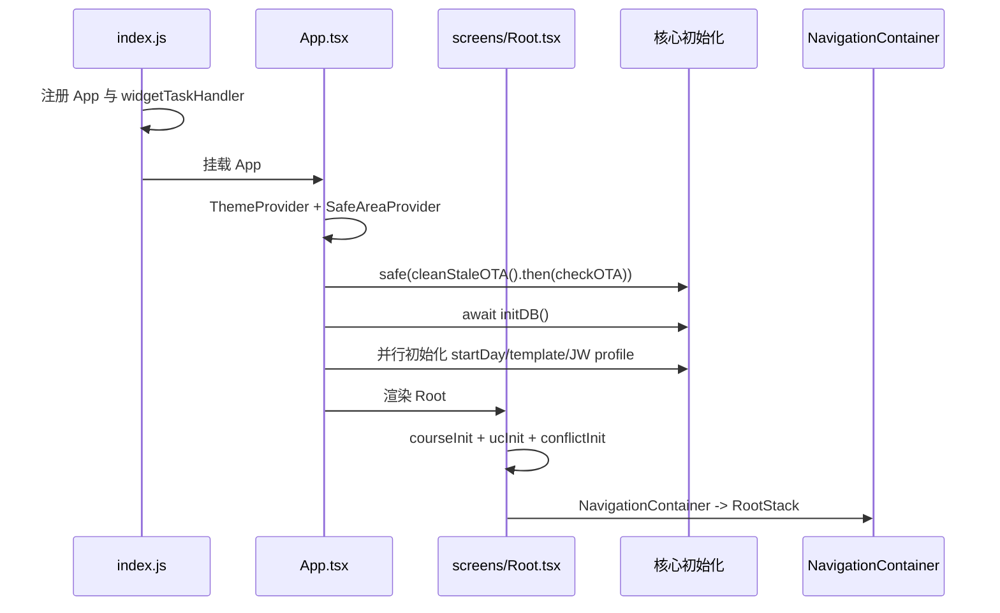

# 启动与导航

## 启动顺序



`index.js` 注册 React 根组件和 `react-native-android-widget` 的小组件 task handler。`App.tsx` 挂载主题和安全区域，先以 `safe()` 隔离 OTA 清理/检查，再等待 `initDB()`；数据库准备好后并行执行 `getCurrentStartDay()`、`migrateTemplates()` 和 JW 账号加载后的 `syncInfo()`。启动阶段不应发起会改变认证状态或 cookie 的业务请求。

`screens/Root.tsx` 恢复 `useUserConfig`、`useCourseData`、`useConflictCourseStore`，这些初始化从同一个 effect 触发但不等待，导航可以先挂载，store 在后台填充。主题由 `generateUiTheme(userConfig, colorScheme)` 计算，`MapPickerHost` 全局挂载。

## 导航树

`src/route/RootStack.tsx` 是顶层 native stack，包含 `main`、`webViewScreen`、`feedback`、`feedbackList`、`feedbackDetail`。`main` 进入 `src/screens/MainTab.tsx` 的三个 tab：

| Tab | Stack | 初始页 |
|---|---|---|
| `home`（首页） | `HomeStack` | `HomeScreen` |
| `tool`（工具箱） | `ToolboxStack` | `toolboxIndex` |
| `setting`（设置） | `SettingStack` | `settingIndex` |

### 首页

`HomeScreen` 展示 `UpdateCard`、`ScheduleCard`；`ScheduleEdit` 提供手动课表编辑。

### 工具箱

入口 `screens/tool/ToolboxIndex.tsx`。主要路由包括：个人/班级课表与导出、考勤、考试信息与成绩/GPA、自选课、选课策略、教师查询、物理实验、工程训练、调课通知、节假日、OA 文件、教学评价、地图/楼层、校园网充值 WebView、小组件预览、全校课表和 `TestPage`。具体组件路径以 `src/route/screens/ToolboxStack.tsx` 为准。

### 设置

`settingIndex` 下包括偏好、个人信息、JW/CA/考勤账号、课程和考试显示项、版本列表、OTA 列表等页面。

## WebView 与 deep link

`src/hooks/app.ts` 的 `useWebView` 是进入 `webViewScreen` 的统一入口：`openInWeb(title, source)` 接收任意 `WebViewSource`；`openInJw(url, title?)` 会在 URL 前拼接 `https://jwxt2018.gxu.edu.cn/jwglxt`。`WebViewScreen` 的 `onOpenWindow` 会把弹窗推成新的 `webViewScreen`，因此支持返回；没有传标题时使用页面 `document.title`。

原生 `MainActivity` 对 `http`/`https` 注册了无 host 限制的 `VIEW` filter，外部打开的匹配链接会落到应用，但没有额外的应用内 deep-link 业务处理。

## 验证

仓库没有完整 Jest 测试。导航/启动改动至少运行：

```bash
pnpm start
pnpm android
npx tsc --noEmit
```

其中类型检查当前可能包含历史全局错误，仍需确认本次改动没有新增错误。
