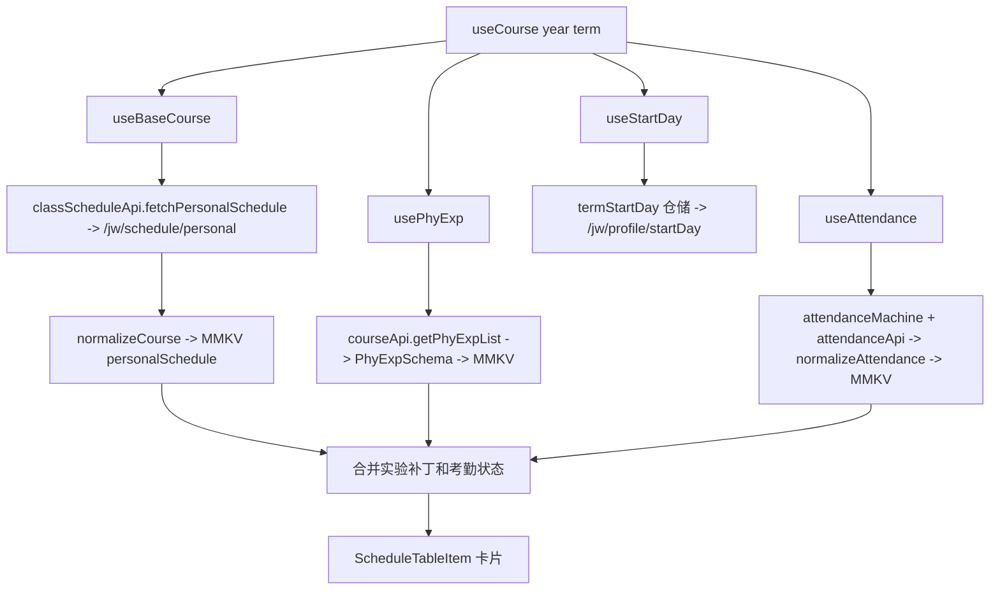

# 课表数据层

课表是应用“获取 → 缓存 → 标准化 → 合并 → UI”的参考实现。各来源都有 Zustand store、MMKV/AsyncStorage 缓存和 `normalize*` 步骤。

## 主链路

## 主要 hook

- `useBaseCourse` 从 MMKV `personalSchedule` 预填，`init(year, term)` 调 `classScheduleApi.fetchPersonalSchedule`，成功才更新缓存和规范化列表。
- `normalizeCourse` 读取 adapter `Schedule.theoryList`（`courseName`、`weekday`、`weeks`、`begin`、`end`、`venueName`、`teacher`、`qqGroup`、`sectionRange`），每个周次展开一条 item，id 为 `${courseName}-${week}-${weekday}-${sectionRange}`。
- `useExam` 校验 `originalExamList`，调用旧 `examApi.getExamInfo`，按固定 13 段 `timeSpanList` 解析 `YYYY-MM-DD (HH:mm-HH:mm)` 并计算 week。
- `useAttendance` 只有 `refreshToken()` 后认证成功才查 `getBySchoolTerm(year, term)` 和 `getPersonalData(calendarId, 1000)`；`atdStateId` 写入 item.status。
- `usePhyExp` 用 `PhyExpSchema` 解析并把标题为“大学物理实验”的理论课按 `classDate` 替换为具体实验、教师和地点。
- `usePractice` 复用个人课表接口，只保留 `practiceList`，写入 AsyncStorage `practiceSchedule`。
- `useShift` 读取 `https://file.unde.site/GxuToolApp/data.json` 的 `timeShift`，休息日移除课程并在工作日以 `isShift: true` 加回。
- `useHoliday` 把硬编码节假日范围展开成 `begin:1,end:13,kind:"holiday"` 的全天 item。

## 组合与风险

`useCourse` 先同步缓存，再并行刷新；物理实验使用模块级 `phyIdx` 按数组顺序配对，任一列表排序都会导致错配。考勤覆盖使用 `week-day-begin-end` key，未认证时不修改课程。`useStartDay()` 不接收参数，调用方传入的 year/term 被忽略，仓储仍通过 `/jw/profile/startDay` 获取并写入 `termStartDay`。

颜色由 `colorPalette.ts` 和 `useBlocksColor.ts` 生成，支持 default、macaron、morandi、vivid；用户自定义 `color` 优先。

验证：`npx tsc --noEmit`、真机手动刷新首页；适配器 parser test 是唯一现成的标准化测试证据。
