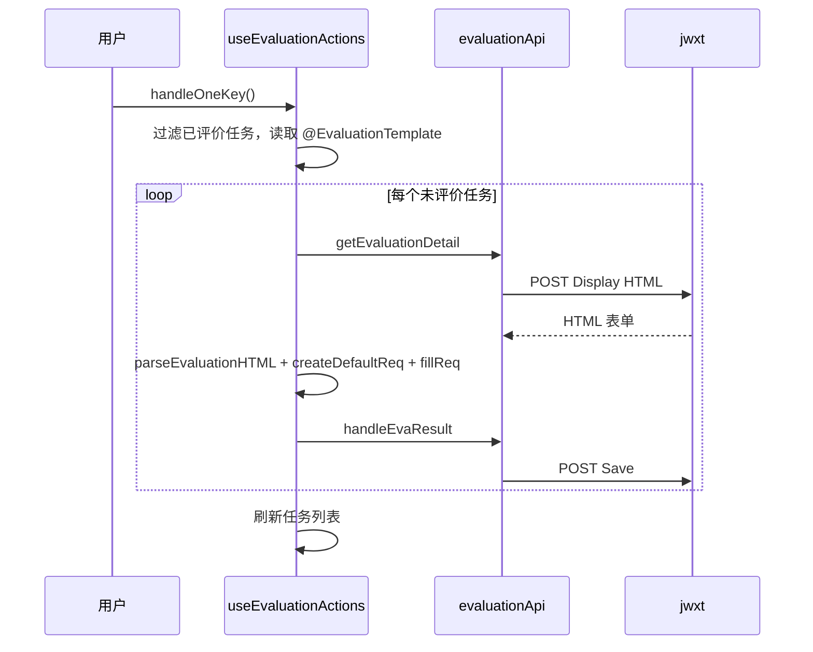

# 教学评价

评价功能读取学期任务列表，获取每门课的 HTML 表单，解析题目和选项，套用保存的模板，先保存草稿，最后提交。

## 接口

文件：`src/features/evaluation/api/index.ts`。

- `getEvaluationListFromBackend()`：认证后 `GET /jw/evaluation`，返回 `EvaTeacherList[]`。
- `getEvaluationList()`：直连 jwxt `POST /xspjgl/xspj_cxXspjIndex.html?doType=query&gnmkdm=N401605`，body 的 `queryModel.showCount = 150`，用 `TeacherListRes.safeParse` 校验。
- `getEvaluationDetail(shaWord, classId, courseId, xsdm, pjmbmcb_id)`：`POST /xspjgl/xspj_cxXspjDisplay.html?gnmkdm=N401605`，body 字段分别为 `jgh_id`、`jxb_id`、`kch_id`、`xsdm`、`pjmbmcb_id`，返回原始 HTML。
- `handleEvaResult(Params1, Params2?)`：`POST /xspjgl/xspj_bcXspj.html?gnmkdm=N401605` 保存草稿，body 实际是 `{...Params1, ...Params2}`。函数声明的默认 `Params3` 没有 spread 进去，因此“用默认参数清空已有评价”的注释与实现不一致。
- `submitEvaResult(Params1, Params2?)`：`POST /xspjgl/xspj_tjXspj.html?gnmkdm=N401605` 提交，并始终附加 `{jszdpjbl: "0", xykzpjbl: "0"}`。

直连接口都用 `src/core/http.ts` 的 `objectToFormUrlEncoded` 编码。

## 一键流程

`useBatchProcessor` 串行处理并维护进度/取消；`useEvaluationActions` 提供 `handleOneKey`、`handleClear`、`submit`。

## 状态、模板与风险

`EvaReducer` 的 `SELECT_OPTION` 固定 `teacherIdx = 0`，选择始终写入第一个教师槽；其余 action 是普通状态设置。模板存在两条路径：当前一键流程读取 AsyncStorage `@EvaluationTemplate`，新表 `evaluationTemplates` 由 `template.ts` 提供 CRUD。`defaultTemplate.ts` 的 `migrateTemplates` 未 await 查询和插入，启动并发时可能重复创建默认模板。

页面路由为 `EvaluationOverview`、`EvaluationDetail`、`EvaluationComment`、`EvaluationTemplate`；解析器是 `utils/parser.ts`，请求构造是 `utils/reqBuilder.ts`。

验证：`npx tsc --noEmit`，并确认缺模板时走 `onNeedTemplate()`，不会直接提交。
