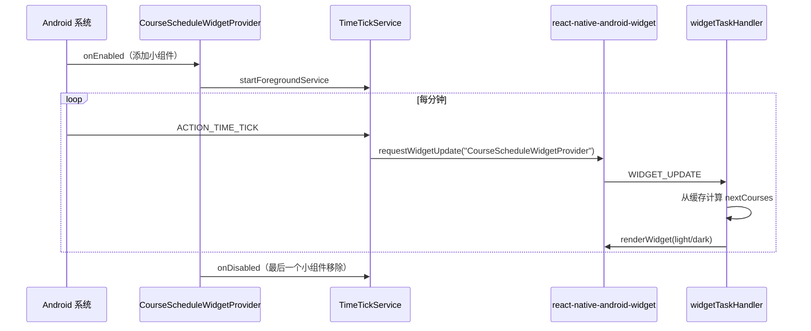

# 小组件总览

应用通过 `react-native-android-widget` 渲染桌面“课程表”小组件。JS 侧定义 UI 和 task handler，原生侧提供 `AppWidgetProvider` 与按分钟触发的前台服务。

## 注册与任务处理

`index.js` 同时注册应用和 `registerWidgetTaskHandler(widgetTaskHandler)`。`src/widget/widget-task-handler.tsx` 将 provider `CourseScheduleWidgetProvider` 映射到 `CourseScheduleWidget`：

- `WIDGET_ADDED`、`WIDGET_UPDATE`、`WIDGET_RESIZED`：读取 `nextCourses()` 后渲染 light/dark。
- `WIDGET_CLICK` 且 `clickAction === "REFRESH_SCHEDULE"`：重新读缓存并刷新时间。
- `WIDGET_DELETED`：不处理。

## 数据源与已知断点

`src/js/nextCourses.ts` 从旧版 AsyncStorage 读取 `courseRes`（`OriginalSchedule`/`kbList`）和 `userConfig`，用 `CourseSchema.safeParse`、`parseWeeks` 展开周次，再结合 `startDay`、`weekday`、`periodCount` 和固定 `timeSpanList` 计算今天、明天及下一节课。

当前没有源码写入 `courseRes`；新课表链路写入 MMKV 的 `personalSchedule`。因此新安装可能只能显示空状态，除非保留旧版本缓存。小组件只读缓存，点击刷新不访问网络。颜色由 `src/widget/widgetData.ts` 的 `getColorForCourse` 对课程名稳定 hash 到 8 色调色板。

## UI 状态

`CourseScheduleWidget.tsx` 有三种状态：今天有课（最多 4 行，超出显示剩余节数）、今天无课但明天有课、今明两天都无课。每次渲染显示 `lastUpdated`（缺省用 `moment().format("MM-DD HH:mm")`）和 `REFRESH_SCHEDULE` 刷新按钮；`CourseItem.tsx` 负责单行课程。

## 原生刷新循环

`CourseScheduleWidgetProvider.java` 启停 `TimeTickService.java`。服务监听 `ACTION_TIME_TICK`，调用 `RNWidgetJsCommunication.requestWidgetUpdate`；使用 `specialUse` 前台服务、`TimeTickServiceChannel` 持久通知，Android 13+ 用 `Context.RECEIVER_NOT_EXPORTED`，销毁时注销 receiver，`onStartCommand` 返回 `START_NOT_STICKY`。

## 验证

暂无自动化测试。手动添加小组件，检查今天/明天课程、点击刷新，并观察分钟 tick 是否更新时间。
